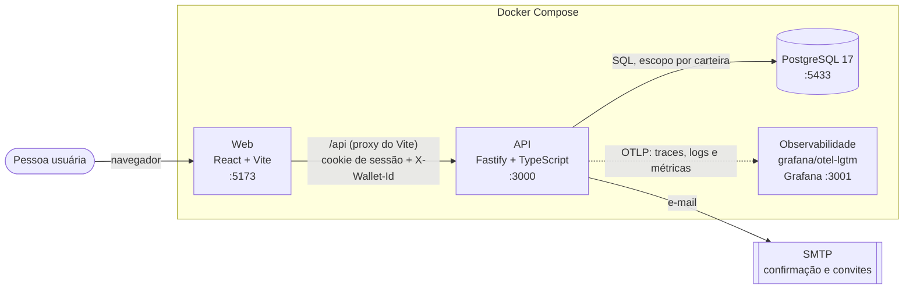
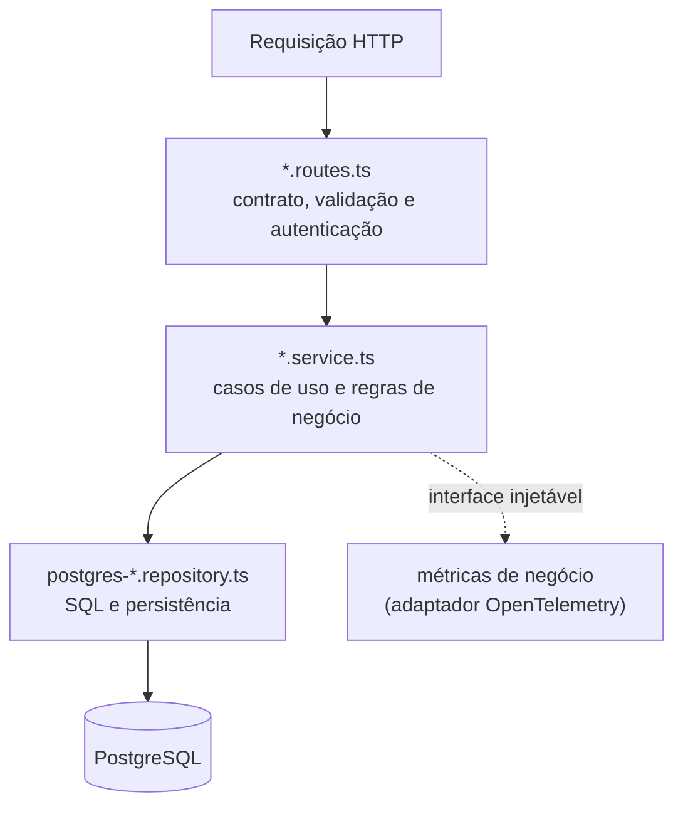
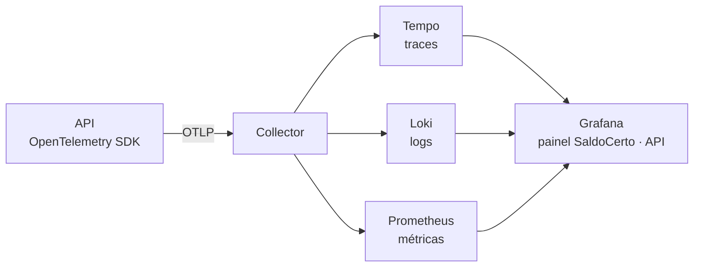
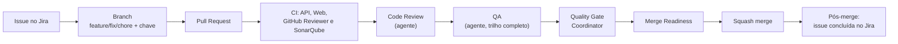

# Saldo Certo

Controle financeiro pessoal e compartilhado. O Saldo Certo organiza entradas, despesas, cartões de crédito e metas de investimento por **carteira**: uma pessoal para cada usuário e outras que podem ser compartilhadas com a família ou o grupo. Ele importa extratos e faturas para tirar do usuário o trabalho de digitar cada lançamento.

> Repositório **CashIn**: o nome do produto é Saldo Certo. Monorepo com API, Web, configuração de infraestrutura e a automação de entrega.

## Funcionalidades

**Conta e acesso**
- Cadastro com confirmação por e-mail, login e sessão autenticada por cookie.
- Senha forte obrigatória e limite de tentativas por IP no cadastro e no login.

**Carteiras**
- Carteira pessoal para cada conta e carteiras adicionais compartilháveis.
- Convite por e-mail, solicitação de acesso por link e administração de membros pelo proprietário.
- Todos os dados financeiros são isolados por carteira, inclusive no banco.

**Lançamentos**
- Categorias e subcategorias por carteira e natureza (entrada, saída e investimento).
- Entradas separadas por saldo: dinheiro, benefício VA/VR e Auxílio Home Office.
- Despesas com forma de pagamento (Pix, débito, crédito e benefícios), com o saldo de cada benefício controlado à parte.
- Valores monetários sempre como decimal exato, nunca ponto flutuante.

**Cartões de crédito**
- Cartões com dia de fechamento e vencimento, fatura calculada por compra.
- Pagamento integral ou parcial e estornos que abatem a fatura.
- Conciliação do pagamento da fatura com o extrato bancário.

**Metas de investimento**
- Metas com valor-alvo e prazo, aportes e progresso calculado, com encerramento.

**Dashboard**
- Resumo do período, comparação com o anterior, metas e categorias de maior gasto.
- Fluxo de caixa com transferências entre carteiras, sem que elas virem receita ou despesa.

**Importação financeira**
- Extratos bancários **OFX** (1.x e 2.x) e **CSV** configurável, com modelos reutilizáveis por carteira.
- Faturas de cartão em OFX e CSV.
- Prévia editável antes de confirmar, detecção de duplicidade, confirmação atômica e desfazer.
- Regras de categorização por carteira, criadas com confirmação do usuário.

O estado detalhado de cada área está em [`docs/knowledge/current-state.md`](docs/knowledge/current-state.md).

## Stack

| Camada | Tecnologia |
| --- | --- |
| API | Node.js 24, TypeScript, Fastify 5, `pg` (sem ORM), migrations SQL versionadas |
| Web | React 19, TypeScript, Vite 8, Vitest, Testing Library, oxlint |
| Banco | PostgreSQL 17 |
| Observabilidade | OpenTelemetry (traces, logs e métricas) e Grafana LGTM: Loki, Grafana, Tempo e Prometheus |
| Ambiente local | Docker Compose |
| Qualidade e entrega | GitHub Actions, SonarQube Cloud, verificação por mutação e agentes de revisão (Code Review, QA, Quality Gate Coordinator) |
| Gestão | Jira, com cada entrega ligada a uma issue |

## Arquitetura

### Visão do sistema



- **API independente do cliente:** a Web é um dos consumidores, e um app mobile pode consumir o mesmo contrato.
- **Escopo por carteira:** a carteira ativa vai no header `X-Wallet-Id`; sem ele, vale a carteira pessoal. Carteira inexistente ou sem acesso responde `404`.
- **Rastreio por requisição:** toda resposta traz `X-Request-Id`, o mesmo `reqId` das linhas de log daquela requisição.

### Camadas da API



Cada domínio (carteiras, categorias, entradas, despesas, cartões, metas, resumo, importações e outros) segue essa divisão em `apps/api/src/<domínio>/`. As regras de negócio não dependem do Fastify nem do banco: o `createApp` recebe os repositórios, o que permite testar os services e as rotas sem PostgreSQL. Os testes de integração rodam contra um PostgreSQL real, num schema descartável.

### Observabilidade



- **Traces:** cada requisição gera um trace com HTTP, Fastify e as consultas ao PostgreSQL.
- **Logs:** as linhas de log carregam o `traceId`, e o Grafana navega do trace aos logs e de volta.
- **Métricas:** latência e erros por rota, pool do banco, processo Node e uso das importações.
- **Dado sensível:** nenhum valor sensível sai do processo. Os traces usam lista de permissão de atributos, os logs não levam query string, corpo, cookie nem IP, e as métricas só aceitam rótulos permitidos.
- **Local:** um container `grafana/otel-lgtm` reúne tudo.
- **VPS:** os componentes ficam separados em [`deploy/observability`](deploy/observability), com autenticação, retenção e nenhuma porta pública. A stack está preparada e testada no CI, mas ainda não foi aplicada.

Guia de uso: [`docs/observability.md`](docs/observability.md).

## Como rodar localmente

**Requisitos:** Docker Desktop com Docker Compose. Node.js 24 e npm só são necessários para rodar testes e builds fora dos containers.

```bash
docker compose up --build
```

| Serviço | Endereço |
| --- | --- |
| Web | http://localhost:5173 |
| API (health) | http://localhost:3000/health |
| PostgreSQL no host | `localhost:5433` |
| Grafana (só nesta máquina) | http://localhost:3001 |

- Opcionalmente, copie `.env.example` para `.env` para ajustar as credenciais locais. As credenciais padrão do Compose valem só para desenvolvimento.
- Para os e-mails de confirmação e convite, preencha `SMTP_USER` e `SMTP_PASSWORD`; o detalhe está em [`docs/api.md`](docs/api.md#confirmação-de-e-mail). Sem SMTP, a API sobe, mas não envia e-mails.
- `docker compose down` para os containers, e `docker compose down -v` remove também os dados locais.
- Depois de uma mudança de dependências da API, o container reinstala os pacotes sozinho na primeira subida.

## Testes e qualidade

```bash
(cd apps/api && npm ci && npm run typecheck && npm test && npm run build)
(cd apps/web && npm ci && npm run lint && npm test && npm run build)
```

- **API:** os testes de integração exigem `TEST_DATABASE_URL` apontando para um PostgreSQL descartável. Sem ela, eles são pulados. Veja [`docs/ci.md`](docs/ci.md).
- **Mutação:** toda guarda nova é provada por mutação. Os mutantes declarados em `mutations/<CHAVE>.json` rodam no CI e falham se algum sobreviver.

## Como entregamos



- **Uma issue, uma branch, um PR:** o PR segue o template de [`.github/pull_request_template.md`](.github/pull_request_template.md).
- **Agentes:** Code Review e QA rodam num runner self-hosted. Só mudanças em Markdown e testes seguem o trilho leve, sem QA.
- **Gate:** o `Merge Readiness` só libera o merge com todas as evidências aprovadas para o mesmo SHA.
- **Pós-merge:** fecha a issue no Jira sozinho.
- **Regras completas:** em [`AGENTS.md`](AGENTS.md) e [`docs/knowledge/automation/delivery-flow.md`](docs/knowledge/automation/delivery-flow.md).

## Estrutura do repositório

```text
apps/api/            API Fastify: domínios em src/<domínio>/, migrations SQL, telemetria
apps/web/            Web React: telas e clientes HTTP por domínio
deploy/observability Stack de observabilidade da VPS, painel do Grafana e smoke tests
docs/                Contratos, guias e o vault de conhecimento (docs/knowledge)
mutations/           Mutantes declarados por entrega, aplicados no CI
tools/               Automação: agentes de revisão, dispatcher do Jira, mutação e vault
.github/             Workflows de CI, revisão, gate e pós-merge
```

## Documentação

| Assunto | Onde |
| --- | --- |
| Endpoints da API | [`docs/api.md`](docs/api.md) |
| Importação financeira | [`docs/financial-imports-contract.md`](docs/financial-imports-contract.md) |
| Resumo do dashboard | [`docs/dashboard-summary-contract.md`](docs/dashboard-summary-contract.md) |
| Observabilidade | [`docs/observability.md`](docs/observability.md) |
| CI e checks | [`docs/ci.md`](docs/ci.md) |
| Arquitetura, domínio, decisões e runbooks | [`docs/knowledge/README.md`](docs/knowledge/README.md) |

O vault em `docs/knowledge/` é a memória versionada do projeto. Comece por [`current-state.md`](docs/knowledge/current-state.md) e confirme o que for crítico nas fontes de código que cada nota indica.

## Estado e próximos passos

- **Deploy:** a VPS própria é o destino. A configuração de observabilidade está pronta, e aplicar qualquer coisa em produção exige pedido explícito.
- **Mobile:** fora do estado atual; a API já atende outros clientes.
- **Limitações conhecidas:**
  - o envio de e-mail e os limitadores de tentativas guardam estado em memória, o que atende a uma instância só;
  - não existe papel somente leitura em carteira compartilhada.

  A lista completa está no [estado atual](docs/knowledge/current-state.md#limitações-conhecidas).
