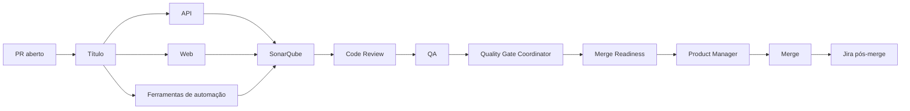

# Fluxo de entrega

**Status:** ativo
**Última revisão:** 03/11/2026

## Sequência real

1. Um PR para `master` dispara o workflow `CI`.
2. `PR title` valida o título e a chave Jira da branch.
3. `API`, `Web` e `GitHub Reviewer` executam após essa validação.
4. `SonarQube` depende das três verificações anteriores e aguarda o Quality Gate.
5. Com o CI aprovado, a orquestração confirma que o HEAD contém a `master` atual antes de chamar qualquer Agent. Depois executa Code Review, publicação formal, QA e consolidação determinística do Quality Gate Coordinator.
6. `Merge Readiness` consolida as evidências do HEAD atual e publica um status determinístico.
7. O Product Manager só integra quando checks, revisão e QA estão aprovados.
8. O evento de merge em `master` dispara o fechamento idempotente da issue Jira associada.

## Regras

- Toda evidência precisa corresponder ao HEAD SHA atual.
- Branch `behind` ou `diverged` interrompe a rodada antes de consumir Code Review ou QA; a atualização da branch deve acontecer antes de uma nova execução.
- Resultado ausente, desatualizado ou inacessível fecha o fluxo com segurança.
- Comentário textual não substitui revisão formal.
- Code Review só conclui depois de cobrir todos os arquivos e áreas de risco; QA só conclui depois de registrar resultado e evidência para cada critério seguro e independente.
- Falha exclusiva de publicação é recuperada com o artefato estruturado original, sem repetir a chamada de modelo; workflow, run, tentativa do job e ID do artefato são autenticados pela API do GitHub antes do download. Se houver reexecuções, somente o artefato correlacionado à tentativa bem-sucedida mais recente é selecionado.
- Falha de infraestrutura antes da criação de um resultado estruturado deixa o job do Agent vermelho, permitindo reexecutar somente o job falho e seus dependentes. Decisões estruturadas continuam publicáveis antes do encerramento fail-closed da rodada.
- O merge não é executado pelos workflows de agentes ou pelo Merge Readiness.

## Economia de execução

- Review e QA usam o Claude Code por padrão (Codex como alternativa), em sessão isolada sem ferramentas, MCP, hooks ou configuração local; o Coordinator cruza as evidências publicadas sem chamada de modelo. CI verde não substitui QA.
- Resultados válidos são reutilizados por SHA/contexto; `INCONCLUSIVE` inalterado só é reanalisado com `retry_inconclusive` no dispatch manual após resolver o bloqueio.
- O Merge Readiness avalia após o CI, quando uma revisão formal muda e após o relatório final do Coordinator. Relatórios intermediários de Code Review e QA e edições de metadados não criam avaliações equivalentes adicionais.
- O cache de pacotes npm é reutilizado entre jobs compatíveis; cada job continua executando instalação limpa e checkout confiável.
- A rodada termina antes de uma repetição no mesmo grupo; os checkouts deixam `ref` sem configuração explícita para preservar a ref confiável do evento e o SHA imutável associado. O despacho manual continua restrito à `master`; mudanças no HEAD do PR continuam invalidando resultados antigos.
- Edições só de checkboxes não recuperam CI; título ou conteúdo substantivo alterado mantém a recuperação.
- Resumos registram origem do resultado e número de invocações, sem prometer contagem de tokens.

## Fontes verificáveis

- [`AGENTS.md`](../../../AGENTS.md)
- [`.github/workflows/ci.yml`](../../../.github/workflows/ci.yml)
- [`.github/workflows/agent-orchestration.yml`](../../../.github/workflows/agent-orchestration.yml)
- [`.github/workflows/agent-report-recovery.yml`](../../../.github/workflows/agent-report-recovery.yml)
- [`.github/workflows/merge-readiness.yml`](../../../.github/workflows/merge-readiness.yml)
- [`.github/workflows/jira-post-merge.yml`](../../../.github/workflows/jira-post-merge.yml)
