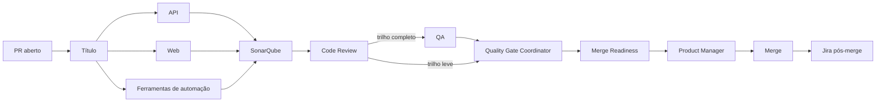

# Fluxo de entrega

**Status:** ativo
**Última revisão:** 08/11/2026

## Sequência real

1. Um PR para `master` dispara o workflow `CI`.
2. `PR title` valida o título e a chave Jira da branch.
3. `API`, `Web` e `GitHub Reviewer` executam após essa validação.
4. `SonarQube` depende das três verificações anteriores e aguarda o Quality Gate.
5. Com o CI aprovado, a orquestração confirma que o HEAD contém a `master` atual antes de chamar qualquer Agent. Depois executa Code Review, publicação formal, **QA quando o trilho é completo** e consolidação determinística do Quality Gate Coordinator.
6. `Merge Readiness` consolida as evidências do HEAD atual e publica um status determinístico.
7. O Product Manager só integra quando checks e revisão estão aprovados, mais o QA quando o trilho é completo.
8. O evento de merge em `master` dispara o fechamento idempotente da issue Jira associada.

## Trilho de revisão

- Cada rodada é classificada em **completo** ou **leve** a partir da lista de arquivos alterados lida da API do GitHub pelo job privilegiado. O corpo do PR não participa: é conteúdo não confiável.
- A regra lista o que é **inerte**, não o que é sensível. **Leve** somente quando todo arquivo alterado é `*.md`, `*.test.*` ou `docs/knowledge/context-map.json`.
- **Completo** em qualquer outro caso, inclusive migrations, manifestos, lockfiles, Dockerfiles, `compose.yaml`, configuração de build, fixtures, helpers de teste, workflows, o dispatcher do Jira e o próprio avaliador de prontidão. Um caminho que ninguém classificou — num diretório que talvez ainda não exista — exige o trilho completo por omissão.
- A primeira versão desta regra listava os caminhos sensíveis, e o Code Review do [PR #91](https://github.com/TitoStauffer/CashIn/pull/91) mostrou que a forma era insegura: `apps/api/migrations/**`, os manifestos e `compose.yaml` alteram runtime e ficavam de fora, então uma migration chegaria ao merge sem QA.
- O trilho leve dispensa **somente o QA**, que é a única etapa de modelo no runner serializado.
- O Coordinator roda nos dois trilhos. Ele é determinístico, não chama modelo, e seu relatório publicado é o registro assinado pelo App que declara o trilho e os arquivos que o determinaram.
- Lista de arquivos vazia ou inutilizável classifica como **completo**: ausência de evidência não é mudança de documentação.
- A classificação é função pura da lista de arquivos, que já entra no hash de contexto. Um commit de runtime num PR antes leve muda o hash, invalida as evidências anteriores e exige o trilho completo no HEAD novo — não existe estado em que o trilho desça sozinho.
- O `Merge Readiness` reclassifica por conta própria, no início e no fim da avaliação, e bloqueia se os dois resultados divergirem. Ele nunca aceita a palavra de um Agent sobre o trilho.
- No trilho leve, um relatório de QA do SHA e do contexto atuais que não esteja aprovado continua bloqueando. Dispensar a etapa é decisão de custo, não permissão para descartar evidência que existe. Relatório de outro SHA, de outro contexto ou sem evidência estruturada é tratado como ausente: não é evidência sobre esta revisão, e bloqueá-lo prendia o PR num estado sem saída, porque nenhuma etapa o republica quando o QA não roda mais.

## Regras

- Toda evidência precisa corresponder ao HEAD SHA atual.
- Branch `behind` ou `diverged` interrompe a rodada antes de consumir Code Review ou QA; a atualização da branch deve acontecer antes de uma nova execução.
- Resultado ausente, desatualizado ou inacessível fecha o fluxo com segurança.
- Comentário textual não substitui revisão formal.
- Code Review só conclui depois de cobrir todos os arquivos e áreas de risco; QA só conclui depois de registrar resultado e evidência para cada critério seguro e independente.
- Falha exclusiva de publicação é recuperada com o artefato estruturado original, sem repetir a chamada de modelo; workflow, run, tentativa do job e ID do artefato são autenticados pela API do GitHub antes do download. Se houver reexecuções, somente o artefato correlacionado à tentativa bem-sucedida mais recente é selecionado.
- Falha de infraestrutura antes da criação de um resultado estruturado deixa o job do Agent vermelho, permitindo reexecutar somente o job falho e seus dependentes. Decisões estruturadas continuam publicáveis antes do encerramento fail-closed da rodada.
- O merge não é executado pelos workflows de agentes ou pelo Merge Readiness.

## Economia de execução

- Review e QA usam o Claude Code por padrão (Codex como alternativa), em sessão isolada sem ferramentas, MCP, hooks ou configuração local; o Coordinator cruza as evidências publicadas sem chamada de modelo. CI verde não substitui QA.
- O trilho leve não executa o QA, então uma rodada de documentação deixa de ocupar o runner serializado. É a economia da [DEV-116](https://titostauffer.atlassian.net/browse/DEV-116): o custo era throughput, porque o runner é único e uma rodada de documentação atrasava a próxima entrega de produto.
- Resultados válidos são reutilizados por SHA/contexto; `INCONCLUSIVE` inalterado só é reanalisado com `retry_inconclusive` no dispatch manual após resolver o bloqueio.
- O Merge Readiness avalia após o CI, quando uma revisão formal muda e após o relatório final do Coordinator. Relatórios intermediários de Code Review e QA e edições de metadados não criam avaliações equivalentes adicionais.
- O cache de pacotes npm é reutilizado entre jobs compatíveis; cada job continua executando instalação limpa e checkout confiável.
- A rodada termina antes de uma repetição no mesmo grupo; os checkouts deixam `ref` sem configuração explícita para preservar a ref confiável do evento e o SHA imutável associado. O despacho manual continua restrito à `master`; mudanças no HEAD do PR continuam invalidando resultados antigos.
- Edições só de checkboxes não recuperam CI; título ou conteúdo substantivo alterado mantém a recuperação.
- O job `Recover CI after metadata edit` executa **sempre que a validação de metadados passa** — ele mantém `needs: pr-title`, então segue pulado quando título ou branch reprovam — e decide internamente (DEV-110). O portão do ator saiu do nível do job e virou condição de passo, então a recuperação continua restrita às edições humanas substantivas, e cada edição publica uma conclusão que **reflete uma avaliação**, em vez de um `skipped` que não diz nada sobre o head.
- **Como o check desse job se comporta, medido na API e não inferido:** job pulado por `if` de nível de job **publica** check run, com conclusão `skipped` — check run `128994959193`, head `636e262`. As conclusões **coexistem** na mesma SHA: nesse mesmo head, `128991498373` com `failure` às 05:09:34Z e `128994959193` com `skipped` às 05:21:11Z, mesmo nome. E o workflow `PR title` roda em `pull_request_target`, cujo `head_sha` é o topo da `master` no momento, não o head do PR, então execuções seguintes publicam em SHAs diferentes conforme a `master` anda. Consequência: o que elimina um vermelho obsoleto é parar de produzi-lo, não uma conclusão posterior apagando a anterior.
- A execução de CI do head é identificada pela consulta — workflow `ci.yml`, evento `pull_request` e `head_sha` —, não pelo campo `pull_requests` do run. Esse campo vem **vazio** nessas execuções, e exigi-lo fazia o job falhar por tempo esgotado em toda edição substantiva de metadados. Array vazio não significa "de outro PR"; quando vem preenchido, continua sendo conferido.
- Falha desse job distingue **três** casos, cada um nomeando a condição que o produziu: não existe execução de CI para o head; existe e não concluiu na janela de espera; ou existe execução no head que o GitHub associa a **outro** Pull Request. Os três continuam falhando fechado.
- Resumos registram origem do resultado e número de invocações, sem prometer contagem de tokens.

## Fontes verificáveis

- [`AGENTS.md`](../../../AGENTS.md)
- [`.github/workflows/ci.yml`](../../../.github/workflows/ci.yml)
- [`.github/workflows/agent-orchestration.yml`](../../../.github/workflows/agent-orchestration.yml)
- [`.github/workflows/agent-report-recovery.yml`](../../../.github/workflows/agent-report-recovery.yml)
- [`.github/workflows/merge-readiness.yml`](../../../.github/workflows/merge-readiness.yml)
- [`.github/workflows/jira-post-merge.yml`](../../../.github/workflows/jira-post-merge.yml)
