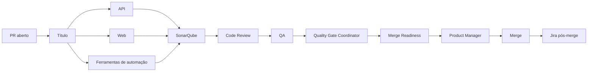

# Fluxo de entrega

**Status:** ativo
**Última revisão:** 25/10/2026

## Sequência real

1. Um PR para `master` dispara o workflow `CI`.
2. `PR title` valida o título e a chave Jira da branch.
3. `API`, `Web` e `GitHub Reviewer` executam após essa validação.
4. `SonarQube` depende das três verificações anteriores e aguarda o Quality Gate.
5. Com o CI aprovado, `Codex Agent Orchestration` executa Code Review, publicação formal, QA e Quality Gate Coordinator.
6. `Merge Readiness` consolida as evidências do HEAD atual e publica um status determinístico.
7. O Product Manager só integra quando checks, revisão e QA estão aprovados.
8. O evento de merge em `master` dispara o fechamento idempotente da issue Jira associada.

## Regras

- Toda evidência precisa corresponder ao HEAD SHA atual.
- Resultado ausente, desatualizado ou inacessível fecha o fluxo com segurança.
- Comentário textual não substitui revisão formal.
- O merge não é executado pelos workflows de agentes ou pelo Merge Readiness.

## Fontes verificáveis

- [`AGENTS.md`](../../../AGENTS.md)
- [`.github/workflows/ci.yml`](../../../.github/workflows/ci.yml)
- [`.github/workflows/agent-orchestration.yml`](../../../.github/workflows/agent-orchestration.yml)
- [`.github/workflows/merge-readiness.yml`](../../../.github/workflows/merge-readiness.yml)
- [`.github/workflows/jira-post-merge.yml`](../../../.github/workflows/jira-post-merge.yml)
